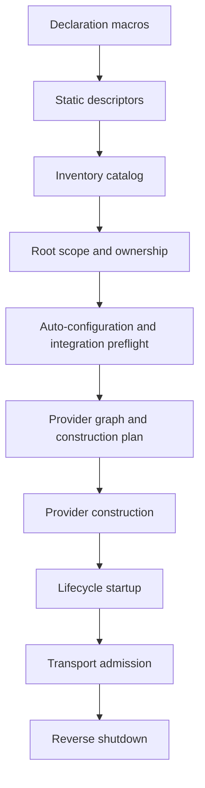

# furnace-rs implementation guide

This guide explains how the current 2.0.0-beta.3 workspace is assembled and
how an application moves from declarations to serving. It is for contributors
and readers tracing implementation behavior. The [architecture guide](ARCHITECTURE.md),
[gRPC guide](grpc.md), [CLI reference](CLI.md), [declarative DI guide](declarative-di.md),
[persistence guide](furnace-rs-persistence.md), and package READMEs remain the
sources for application-facing syntax and setup.

## Workspace boundaries

The dependency direction keeps application semantics in the core and puts each
transport or tool in a separate integration crate.

| Crate | Owns | Main implementation |
| --- | --- | --- |
| [`furnace-rs-core`](../crates/furnace-rs-core/README.md) | Provider and cauldron metadata, selected dependency graphs, configuration, diagnostics, construction, and lifecycle. | [`builder.rs`](../crates/furnace-rs-core/src/builder.rs), [`graph/mod.rs`](../crates/furnace-rs-core/src/graph/mod.rs), [`configuration/mod.rs`](../crates/furnace-rs-core/src/configuration/mod.rs), [`lifecycle.rs`](../crates/furnace-rs-core/src/lifecycle.rs) |
| [`furnace-rs-core-macros`](../crates/furnace-rs-core-macros/README.md) | Core declaration, injector, configuration, entry-point, and test attributes. | [`src/`](../crates/furnace-rs-core-macros/src/) |
| [`furnace-rs-common`](../crates/furnace-rs-common/README.md) | HTTP, validation, Passport/JWT, cookies, logging, static inspection, and shared runtime coordination. | [`router.rs`](../crates/furnace-rs-common/src/router.rs), [`passport/mod.rs`](../crates/furnace-rs-common/src/passport/mod.rs), [`runtime/mod.rs`](../crates/furnace-rs-common/src/runtime/mod.rs) |
| [`furnace-rs-common-macros`](../crates/furnace-rs-common-macros/README.md) | HTTP/controller, input-validation, Passport, and route declaration macros. | [`src/`](../crates/furnace-rs-common-macros/src/) |
| [`furnace-rs-grpc`](../crates/furnace-rs-grpc/README.md) | Native Tonic/Prost service and client transports, gRPC Passport adapters, health, reflection, TLS, and runtime serving. | [`grpc/mod.rs`](../crates/furnace-rs-grpc/src/grpc/mod.rs), [`runtime/mod.rs`](../crates/furnace-rs-grpc/src/runtime/mod.rs) |
| [`furnace-rs-grpc-macros`](../crates/furnace-rs-grpc-macros/README.md) | Protobuf service, managed client, and reflection declarations. | [`src/`](../crates/furnace-rs-grpc-macros/src/) |
| [`furnace-rs`](../crates/furnace-rs/README.md) | Application-facing facade, feature composition, and prelude. | [`src/lib.rs`](../crates/furnace-rs/src/lib.rs) |
| [`furnace-rs-persistence`](../crates/furnace-rs-persistence/README.md) | Optional native SeaORM PostgreSQL connector and database module. | [`sea_orm/mod.rs`](../crates/furnace-rs-persistence/src/sea_orm/mod.rs) |
| [`furnace-rs-testing`](../crates/furnace-rs-testing/README.md) | Focused provider fixtures, lifecycle ownership, and in-process HTTP assertions. | [`fixture.rs`](../crates/furnace-rs-testing/src/fixture.rs), [`http.rs`](../crates/furnace-rs-testing/src/http.rs) |
| [`furnace-rs-cli`](../crates/furnace-rs-cli/README.md) | Cargo-native build/run/dev, inspection, output, and project scaffolding. | [`src/lib.rs`](../crates/furnace-rs-cli/src/lib.rs) |
| [`furnace-rs-extra`](../crates/furnace-rs-extra/README.md) | A feature-gated extension boundary; scheduled APIs are not implemented in this release. | [`src/lib.rs`](../crates/furnace-rs-extra/src/lib.rs) |

The facade depends on core directly and enables common, gRPC, and extra only
through its feature set. Persistence is separate and is not pulled in by the
facade's `sea-orm` feature. That feature enables common's HTTP conversion for
SeaORM `DbErr`; `furnace-rs-persistence/sea-orm-postgres` adds the PostgreSQL
connector and lifecycle-managed native connection.

The facade feature combinations are defined in
[`crates/furnace-rs/Cargo.toml`](../crates/furnace-rs/Cargo.toml):

| Facade feature | Composition |
| --- | --- |
| `default` | `common` and `runtime-tokio`; `common` means HTTP plus logger. |
| `http` | Common's Axum transport, routing, validation, and REST errors. |
| `jwt` | Common JWT/Passport contracts; with gRPC enabled, the gRPC JWT adapter. |
| `cookies` | HTTP plus common cookie support. |
| `grpc` | The standalone gRPC crate; it does not enable HTTP. |
| `grpc-tls` | `grpc` plus verified gRPC TLS support. |
| `sea-orm` | HTTP plus common's `DbErr` response conversion; no database driver. |
| `extra` | The post-v1 extension crate. |
| `runtime-tokio` | Tokio support for the core entry point and runtime integrations. |

`furnace-rs-common` defaults to `http`; gRPC disables those defaults and uses
common's transport-neutral metadata and runtime features. This lets a gRPC-only
facade build omit Axum, while `grpc` plus `http` can use the shared runtime. See
the [facade feature matrix](../crates/furnace-rs/tests/feature_matrix.rs) for
compile-time checks of these boundaries.

## From declarations to a selected application

Procedural macros validate declaration syntax and emit ordinary Rust
implementations plus static metadata. They do not construct application
providers. Core macros implement cauldron and injector contracts and register
descriptors; common macros emit controller, route, validation, and Passport
metadata; gRPC macros attach descriptor sets and typed server/client adapters.
The implementations are in [core macros](../crates/furnace-rs-core-macros/src/),
[common macros](../crates/furnace-rs-common-macros/src/), and
[gRPC macros](../crates/furnace-rs-grpc-macros/src/).

At runtime, the catalog combines linked descriptors and the selected root. A
rooted build traverses reachable cauldrons, records ownership and explicit
exports, and analyzes concrete output and dependency types. Unrooted low-level
builders retain complete-catalog compatibility. Graph analysis produces
deterministically ordered diagnostics and a construction plan before provider
constructors run.

`FurnaceBuilder::analyze` is the metadata-only stage. Official auto-configurations
and registered preflight validators inspect the selected virtual graph and
configuration before construction. They can reject missing outputs, invalid
transport metadata, or missing strategies without invoking provider constructors.
The graph planner then rejects duplicate/ambiguous outputs, unavailable
dependencies, and cycles. Selected injectors construct outputs in plan order and
retain them in the application registry. See [`catalog.rs`](../crates/furnace-rs-core/src/catalog.rs),
[`preflight.rs`](../crates/furnace-rs-core/src/preflight.rs),
[`graph/analysis.rs`](../crates/furnace-rs-core/src/graph/analysis.rs),
[`graph/plan.rs`](../crates/furnace-rs-core/src/graph/plan.rs), and
[`builder.rs`](../crates/furnace-rs-core/src/builder.rs).

Cauldron membership and imports control DI visibility. A module can provide
values and controllers; imports expose declared exports, and reachable global
modules participate through the selected graph. Rust `pub` visibility does not
grant DI visibility. Provider descriptors also declare constructor dependencies
and optional lifecycle behavior; they are not inferred from arbitrary Rust
calls.

## Configuration and lifecycle

The conventional entry point loads its standard sources before building the
root: optional dotenv interpolation, optional `furnace.toml`, then environment
overrides. The low-level builder accepts explicit `Config` and does not load
those sources. A `Configuration` derive parses a typed view only when requested;
configuration types are not discovered globally. Source attribution is
preserved for keys and path values. `Secret<T>` requires explicit exposure and
redacts ordinary formatting. The loader and typed parser are in
[`config.rs`](../crates/furnace-rs-core/src/config.rs) and
[`configuration/mod.rs`](../crates/furnace-rs-core/src/configuration/mod.rs);
conventional startup is in
[`runtime/burn.rs`](../crates/furnace-rs-common/src/runtime/burn.rs).

The application owns constructed values and lifecycle hooks. Infrastructure
hooks start before application hooks. A startup failure rolls back hooks already
started; normal shutdown awaits hooks in reverse order and retains both
operation and shutdown failures. These rules are implemented by
[`lifecycle.rs`](../crates/furnace-rs-core/src/lifecycle.rs) and the retained
[`context.rs`](../crates/furnace-rs-core/src/context.rs).

Lifecycle progress survives cancellation. After interrupted startup, call
`shutdown()` to clean up completed starts; after interrupted shutdown or rollback,
call it again to resume cleanup. Completed stops are not repeated. A pending
startup hook owns its partial effects, and a pending stop must tolerate retry.

## HTTP request path

HTTP controller and endpoint declarations create static descriptors. Selected
scope validation checks reachable controllers, endpoint conflicts, guards, and
required strategy outputs before router construction. The router resolves
controller instances and composes Axum method routers. The route, scope, and
server boundaries are in [`route.rs`](../crates/furnace-rs-common/src/route.rs),
[`http_scope.rs`](../crates/furnace-rs-common/src/http_scope.rs), and
[`router.rs`](../crates/furnace-rs-common/src/router.rs).

Validated extractors read the request representation, deserialize the target,
run `Input::validate`, attach a body/query/path source to ordered issues, and
invoke the handler only on success. Ordinary Axum extractors keep native
behavior. Validation derives and extractor adapters live in
[`validation/extract.rs`](../crates/furnace-rs-common/src/validation/extract.rs)
and [`extract.rs`](../crates/furnace-rs-common/src/extract.rs). FURNACE-owned
HTTP errors normalize to safe responses; internal causes remain on server-side
error chains rather than appearing in response bodies. See
[`validated_extractors.rs`](../crates/furnace-rs-common/tests/validated_extractors.rs)
and [`response.rs`](../crates/furnace-rs-common/tests/response.rs).

## Passport and JWT admission

Passport policy declarations carry a strategy name, principal type, token
source, and static authorization requirements. The selected guard catalog
validates policy relationships and required strategy/JWT outputs before
construction. At request admission, the transport reads the configured
credential source, delegates verification and strategy execution to the shared
Passport path, evaluates roles/permissions and predicates, then installs typed
`Authenticated
` and verified-claim values in request extensions.

JWT key/configuration and verification are shared in
[`jwt/service.rs`](../crates/furnace-rs-common/src/jwt/service.rs); strategy,
policy, authentication, and guard bindings are in
[`passport/mod.rs`](../crates/furnace-rs-common/src/passport/mod.rs). HTTP
provides its configured Bearer and cookie adapters. The gRPC adapter uses
`authorization` Bearer metadata only and maps rejection, forbidden, and internal
failures to fixed gRPC statuses. A gRPC method guard replaces the service-wide
guard; an explicit public method bypasses an inherited service guard. See
[HTTP Passport tests](../crates/furnace-rs-common/tests/passport_authorization.rs),
[scoped Passport tests](../crates/furnace-rs-common/tests/scoped_passport.rs),
and [gRPC Passport tests](../crates/furnace-rs-grpc/tests/grpc_passport.rs).

## gRPC service and client transports

`#[grpc_service]` is applied to a generated Tonic trait implementation. The
macro emits a static service descriptor containing the generated service name,
encoded protobuf descriptors, method overrides, and a registrar that resolves
the selected implementation. `GrpcApplicationScope` decodes and merges the
selected descriptor sets, checks service/method identity and Rust method
coverage, rejects conflicts, and associates only services in the selected
cauldron scope. Preflight validates guards and named-client configuration before
construction. See [`descriptor.rs`](../crates/furnace-rs-grpc/src/grpc/descriptor.rs),
[`scope.rs`](../crates/furnace-rs-grpc/src/grpc/scope.rs),
[`preflight.rs`](../crates/furnace-rs-grpc/src/grpc/preflight.rs), and
[`router.rs`](../crates/furnace-rs-grpc/src/grpc/router.rs).

The gRPC server keeps Tonic `Routes` as the generated service API and serves
HTTP/2 connections through a supervised Hyper adapter. Each request carries
peer information into Passport dispatch. The `grpc-timeout` deadline bounds
request establishment and dispatch; after a response is established, its body
is not wrapped in a timeout. Dropping the native response and stopping the
request producer retains Tonic cancellation behavior. TLS preparation loads and
validates the configured server identity before serving, sets HTTP/2 ALPN, and bounds
handshakes. Health becomes serving when shared runtime admission opens.
Reflection is opt-in, lists selected descriptors, and can use a root-scoped
guard. See [`server.rs`](../crates/furnace-rs-grpc/src/runtime/server.rs),
[`tls.rs`](../crates/furnace-rs-grpc/src/grpc/tls.rs),
[`health.rs`](../crates/furnace-rs-grpc/src/grpc/health.rs),
[`reflection.rs`](../crates/furnace-rs-grpc/src/grpc/reflection.rs), and
[gRPC runtime tests](../crates/furnace-rs-grpc/tests/grpc_runtime.rs).

`#[grpc_client]` generates a typed wrapper whose `client()` method returns the
native generated Tonic client over `GrpcChannel`. Static client parsing does
not connect or ask a token provider for a token. Eager clients connect during
infrastructure startup; lazy clients establish a channel on first use. A
configured token provider supplies a fresh token per request unless the request
already has an explicit valid Bearer value. Authorization metadata is marked
sensitive. A per-call or configured deadline includes token preparation and
connection/dispatch establishment; it does not truncate an established
streaming response. Closing the shared channel rejects new calls. See
[`client.rs`](../crates/furnace-rs-grpc/src/grpc/client.rs),
[`grpc_clients.rs`](../crates/furnace-rs-grpc/tests/grpc_clients.rs), and
[`grpc_dispatch.rs`](../crates/furnace-rs-grpc/tests/grpc_dispatch.rs).

## Shared runtime and shutdown

HTTP and gRPC contribute transport preparation to one coordinator. Each adapter
validates selected routes and settings before provider construction; after
construction it supplies a listener address, route summary, readiness
transition, serve operation, and optional drain deadline. The coordinator
starts the application once, binds every selected listener, marks health as
serving, and only then admits requests. A bind failure closes any earlier
listeners and runs application shutdown.

On shutdown, health changes to not-serving before accept loops stop. The
coordinator broadcasts one stop signal and joins serving tasks under the
strictest configured drain deadline. When that deadline expires it aborts and
joins supervised transport tasks before shutting down providers. This gives
HTTP and gRPC one owner for lifecycle and shared provider identity. The
coordinator is [`runtime/coordinator.rs`](../crates/furnace-rs-common/src/runtime/coordinator.rs);
the adapters are [`runtime/http.rs`](../crates/furnace-rs-common/src/runtime/http.rs)
and [`runtime/adapter.rs`](../crates/furnace-rs-grpc/src/runtime/adapter.rs).
Facade behavior is checked by
[`grpc_runtime.rs`](../crates/furnace-rs/tests/grpc_runtime.rs).

## Static inspection

The CLI builds the selected application and asks its standard entry point to
run a private inspection mode. The request carries a protocol version, kind,
per-request token, and private acknowledgement/response paths. The child
validates the request, loads read-only configuration, analyzes the selected
graph and integration metadata, publishes an acknowledgement and report, then
exits before provider construction, lifecycle startup, database access, eager
client connection, TLS reads, or listener binding.

The common inspection adapter produces route, graph, doctor, or gRPC metadata.
The CLI verifies the acknowledgement token, supported framework version, child
exit, and complete response before deserializing. It converts reports into safe
human output or public schema-version-2 JSON; partial analysis evidence and
diagnostics are retained when available. See
[`inspection.rs`](../crates/furnace-rs-common/src/inspection.rs),
[`inspection.rs`](../crates/furnace-rs-cli/src/inspection.rs),
[`inspection.rs`](../crates/furnace-rs-common/tests/inspection.rs),
[`inspection_protocol.rs`](../crates/furnace-rs-cli/tests/inspection_protocol.rs),
and [`grpc_inspection.rs`](../crates/furnace-rs-cli/tests/grpc_inspection.rs).

## Persistence and test fixtures

The persistence crate separates a generic `DatabaseConnector`/`DatabaseFactory`
from the optional SeaORM PostgreSQL connector. `DatabaseCauldron` is imported
explicitly; its connector parses settings without opening a connection, then
its injector establishes the native connection during selected provider
construction. Its infrastructure lifecycle hook pings the connection before
listener admission and closes it during shutdown. Errors retain typed causes
and classify configuration, scheme, connection, readiness, and close failures
while avoiding URLs in ordinary formatting. Connection-establishment tracing
is suppressed because the native span includes credential-bearing options.
See [`connector.rs`](../crates/furnace-rs-persistence/src/sea_orm/connector.rs),
[`lifecycle.rs`](../crates/furnace-rs-persistence/src/sea_orm/lifecycle.rs),
and [connector tests](../crates/furnace-rs-persistence/tests/connector.rs).
Live PostgreSQL tests require `FURNACE_TEST_DATABASE_URL` and are ignored when
it is absent.

`furnace-rs-testing` focuses graph construction on one registered subject or
controller and permits private dependencies while preserving Rust visibility.
Supplied values replace constructors; database supply uses the SQLite
`MockDatabase` API. Controller requests run through Tower in process, without a
listener. Fixture execution starts the application, catches an unwinding test
panic, awaits shutdown, then resumes the original panic. See
[`fixture.rs`](../crates/furnace-rs-testing/src/fixture.rs),
[`http.rs`](../crates/furnace-rs-testing/src/http.rs),
[`subject_fixture.rs`](../crates/furnace-rs-testing/tests/subject_fixture.rs),
and [`http_fixture.rs`](../crates/furnace-rs-testing/tests/http_fixture.rs).

## CLI build, dev, and scaffolding

The CLI uses Cargo metadata to resolve a package and binary, streams Cargo JSON
build messages to discover the exact selected executable, and runs that
artifact with application arguments after `--`. The dev loop classifies file
changes as no-op, restart, or rebuild; it debounces event batches, keeps the
last successful application available after a failed build, and awaits build
cleanup and process shutdown. A replacement starts only after its new binary
builds successfully.

Inspection uses the private protocol above. Finite commands render one human
outcome or one newline-terminated JSON document; `run` and `dev` preserve
streamed process output. `furnace new` validates and renders the fixed starter
in memory, creates a private sibling staging directory, writes and syncs files,
then publishes the complete directory without replacing an existing
destination. See [`project.rs`](../crates/furnace-rs-cli/src/project.rs),
[`cargo.rs`](../crates/furnace-rs-cli/src/cargo.rs),
[`dev.rs`](../crates/furnace-rs-cli/src/dev.rs),
[`watch.rs`](../crates/furnace-rs-cli/src/watch.rs),
[`output/mod.rs`](../crates/furnace-rs-cli/src/output/mod.rs),
[`scaffold/publish.rs`](../crates/furnace-rs-cli/src/scaffold/publish.rs),
and the [CLI package guide](../crates/furnace-rs-cli/README.md).

## Test map

| Boundary | Focused verification |
| --- | --- |
| Core graph, configuration, construction, lifecycle | `cargo test -p furnace-rs-core --all-features` and core macro compile-pass/fail suites. |
| HTTP, validation, Passport, JWT, runtime | `cargo test -p furnace-rs-common --all-features`; see the route, Passport, validation, and coordinator suites under [`common/tests`](../crates/furnace-rs-common/tests/). |
| gRPC serving, clients, TLS, reflection, cancellation | `cargo test -p furnace-rs-grpc --all-features`; facade gRPC macro contracts run in `cargo test -p furnace-rs --all-features`. |
| Facade exports and feature composition | `cargo test -p furnace-rs --all-features`, especially [`feature_matrix.rs`](../crates/furnace-rs/tests/feature_matrix.rs) and [`grpc_runtime.rs`](../crates/furnace-rs/tests/grpc_runtime.rs). |
| Persistence connector and lifecycle | `cargo test -p furnace-rs-persistence --all-features`; live PostgreSQL tests need the configured test database. |
| Focused fixtures and in-process HTTP | `cargo test -p furnace-rs-testing --all-features`. |
| CLI parsing, child protocol, dev loop, JSON, scaffold | `cargo test -p furnace-rs-cli --all-features`. |
| Workspace Rustdoc and doctests | `cargo test --workspace --all-features --doc` and `RUSTDOCFLAGS="-D warnings" cargo doc --workspace --all-features --no-deps`. |

Transport tests that bind local listeners need loopback socket access. User-facing
syntax and configuration examples stay in the focused guides linked at the top
of this document.
